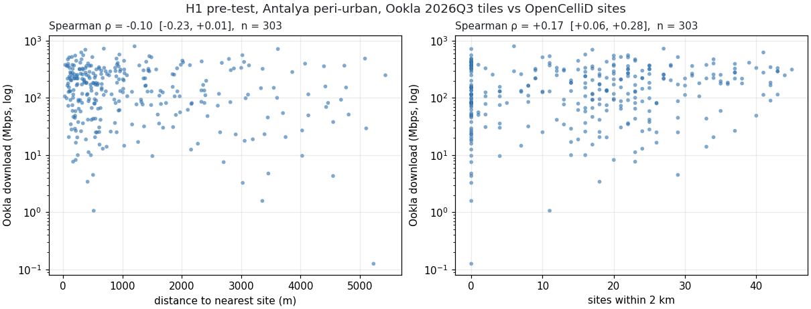
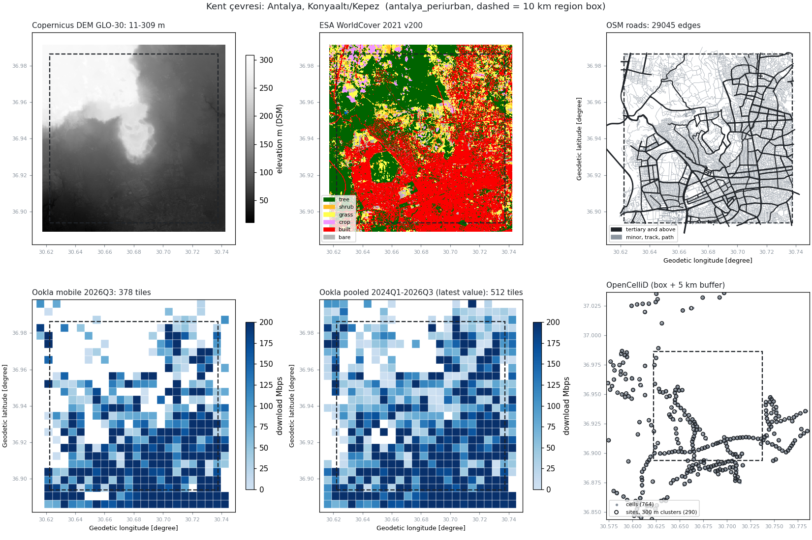
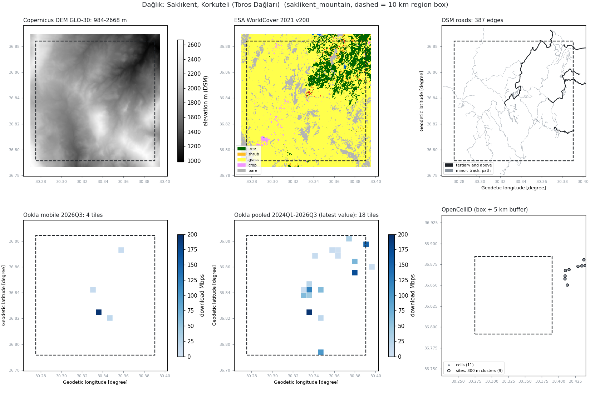
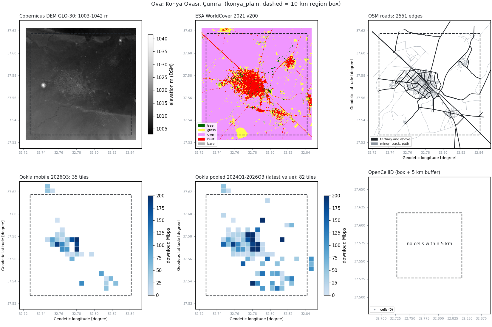

# Faz 0: Veri Fizibilite Raporu

**Proje:** Görev Kritik Sistemler İçin Güvenli Rota Belirleme ve Rota Tercihinin Gerekçelendirilmesi (CSE 491, Grup 7)
**Danışman:** Dr. Öğr. Üyesi Taner Danışman
**Tarih:** 28.10.2026
**Amaç:** Öneride kullanacağımızı söylediğimiz açık verilerin gerçekten indirilebildiğini, test bölgelerini kapsadığını, beklenen çözünürlükte olduğunu ve projede işe yarayacağını sayılarla göstermek.

Bütün sayılar `scripts/` altındaki betiklerle yeniden üretilebilir. Her indirme, kaynağı, tarihi ve SHA256 özetiyle `data/data_manifest.csv` dosyasına kaydedildi. Ayrıntılı tablolar `reports/checks/` klasöründe.

## 1. Özet

| Veri seti | İndirilebildi mi | Türkiye / bölge kapsaması | Çözünürlük | Sorunlar | Karar |
|---|---|---|---|---|---|
| Copernicus DEM GLO-30 (2021) | Evet (AWS S3, hesap gerekmiyor) | Üç bölge tam, boş piksel %0 | 1″ (yaklaşık 25×31 m), 30 m UTM ızgarasına taşındı | Yüzey modeli (DSM): yerleşimde yapay eğim üretiyor (Bölüm 4) | **Kullanılır** |
| ESA WorldCover 2021 v200 | Evet (AWS S3, hesap gerekmiyor) | Üç bölge tam, boş piksel %0; N36E030 karosu üçünü de kapsıyor | 10 m, 30 m'ye `mode` ile indirildi | 2021 tarihli; 30 m'de ince yapılar (dar yol, dere) kayboluyor | **Kullanılır** |
| OpenStreetMap (Geofabrik 2026-10-01) | Evet (Overpass 502 verdiği için tarihli Türkiye dosyası kullanıldı) | Üç bölge, toplam 2.784 km yol | Vektör | `surface`, `tracktype`, `access` etiketleri çok seyrek | **Kullanılır** |
| Ookla Speedtest mobil (2024Q1–2026Q3) | Evet (AWS S3, DuckDB ile uzaktan okundu) | Türkiye 2026Q3 dosyasında var. Bölge alanının kapsanan kısmı: Antalya %67, Konya %7.5, Saklıkent %1 | Zoom 16 karo (yaklaşık 480 m) | Kırsalda çok seyrek; karoların yarısından fazlasında 5'ten az test | **Kullanılır**, bağlantının ana kaynağı; kırsalda koşullu |
| OpenCelliD (MCC 286) | Kısmen: token ile otomatik indirme 403 verdi, dosya tarayıcıdan elle indirildi | Bütün Türkiye için sadece 20.310 hücre. Antalya kutusunda 269 hücre, Saklıkent ve Konya kutularında **0** | Nokta (konum tahmini) | Konumların hepsi tahmin (`changeable=1`), noktalar yollar boyunca diziliyor | **Koşullu**: sadece kent çevresinde, yardımcı veri olarak |
| OSM iletişim direkleri (ek deneme) | Evet (aynı Geofabrik dosyasından) | Türkiye'de 8.368 iletişim direği. Kutularda: Antalya 9, Konya 1, Saklıkent 0 | Nokta | Kırsalda OpenCelliD kadar eksik | **Kullanılmaz** |

Kısacası arazi tarafındaki veriler (yükseklik, eğim, arazi örtüsü, yol) üç bölgede de eksiksiz ve aynı ızgarada hizalı. Bağlantı tarafında Ookla tek güvenilir ölçüm kaynağı. Baz istasyonu konumları ise Türkiye için önerideki planı taşıyacak kadar dolu değil.

## 2. Test bölgeleri

Her bölge UTM 36N (EPSG:32636) koordinat sisteminde 10,02 km'lik bir kare, 334×334 hücre (30 m). Merkezler OSM Nominatim ile yer adından bulundu (`config/regions.yaml`). Kutular danışmanla henüz kesinleşmedi.

| Bölge | Boylam | Enlem | Not |
|---|---|---|---|
| Kent çevresi: Antalya, Konyaaltı/Kepez | 30,622–30,738 | 36,894–36,986 | İlk kutunun %20'si denizdi. Merkez kuzeye kaydırıldı, su oranı %0,03'e indi |
| Dağlık: Saklıkent, Korkuteli | 30,275–30,391 | 36,792–36,884 | Yükseklik 999–2651 m, ortalama 1831 m |
| Ova: Konya Ovası, Çumra | 32,728–32,842 | 37,527–37,617 | Yükseklik 1003–1042 m |

## 3. Veri setleri

### 3.1 Copernicus DEM GLO-30

Bölge pencereleri bulut uyumlu GeoTIFF dosyalarından doğrudan okundu, karonun tamamı indirilmedi. Üç bölgede de boş piksel yok.

| Bölge | En düşük (m) | Ortalama (m) | En yüksek (m) |
|---|---|---|---|
| Antalya | 19 | 134 | 309 |
| Saklıkent | 999 | 1831 | 2651 |
| Konya | 1003 | 1010 | 1042 |

Değerler beklentiyle uyumlu. Antalya'da en düşük değer 0 değil 19 m, çünkü kutu denizi dışarıda bırakacak şekilde kuzeye kaydırıldı.

### 3.2 ESA WorldCover 2021 v200

Sınıf oranları (bölge kutusu içinde, %):

| Bölge | Ağaç | Çalı | Çayır | Tarım | Yerleşim | Çıplak | Su |
|---|---|---|---|---|---|---|---|
| Antalya | 35,8 | 3,0 | 11,6 | 2,7 | 43,2 | 3,6 | 0,03 |
| Saklıkent | 9,5 | 1,1 | 77,8 | 0,9 | 0,2 | 10,5 | 0,07 |
| Konya | 1,0 | 0,0 | 6,6 | 81,3 | 9,1 | 2,0 | 0,0 |

Üç bölge birbirinden belirgin biçimde farklı: kent, dağlık çayır ve tarım ovası. Bu, test bölgelerinin amaca uygun seçildiğini gösteriyor.

### 3.3 OpenStreetMap

Overpass sunucusu iki bölgede 502 hatası verdiği için tarihli Geofabrik Türkiye dosyası (`turkey-261001.osm.pbf`, 649 MB, MD5 doğrulandı) indirildi ve bölgelere kırpıldı. Tarihli dosya kullanmak sonuçların tekrar üretilebilmesini de sağlıyor.

| Bölge | Düğüm | Kenar (yönsüz) | Toplam yol (km) | En büyük üç yol türü (uzunluğa göre) |
|---|---|---|---|---|
| Antalya | 19.365 | 29.045 | 2158 | residential %54, tertiary %9, service %7 |
| Saklıkent | 332 | 387 | 203 | track %53, tertiary %20, unclassified %16 |
| Konya | 1.624 | 2.551 | 423 | residential %42, tertiary %29, track %12 |

Konya'da tarla yolları (`track`) OSM'de eksik görünüyor: 100 km²'lik tarım ovasında sadece 49 km var.

### 3.4 Ookla Speedtest mobil

Türkiye 2026Q3 dosyasında yer alıyor. Kırsal bölgelerde karo sayısını artırmak için 2024Q1–2026Q3 arasındaki 11 çeyrek birleştirildi.

| Bölge | Karo, 2026Q3 | Alan kapsaması, 2026Q3 | Karo, 11 çeyrek birleşik | Alan kapsaması, birleşik | 5'ten az testli karo (2026Q3) | Medyan indirme (Mbps) |
|---|---|---|---|---|---|---|
| Antalya | 303 | %67,0 | 383 | %85,6 | %51,8 | 144 |
| Saklıkent | 4 | %1,0 | 16 | %3,7 | %75,0 | 16 |
| Konya | 32 | %7,5 | 76 | %17,7 | %90,6 | 51 |

Çeyrekleri birleştirmek karo sayısını Saklıkent'te 4 kat, Konya'da 2,4 kat artırıyor, ama kırsal alanın büyük kısmı yine boş kalıyor. Bir karonun olmaması o yerde kapsama olmadığını değil, orada ölçüm yapılmadığını gösteriyor. Bu ikisini ayrı tutuyoruz.

### 3.5 OpenCelliD

Satırlar baz istasyonu değil, hücre (anten sektörü). Bu yüzden hücreler 300 m'lik tam bağlantılı (complete linkage) kümelemeyle sitelere toplandı. 300 m eşiği LTE hücre kimliklerinden kalibre edildi: Antalya'da aynı eNB'ye ait hücrelerin konumları arasındaki farkın medyanı yaklaşık 290 m.

| Bölge | Hücre (kutu içinde) | Site (kümeleme sonrası) | LTE eNB | `changeable=1` | GSM / UMTS / LTE / NR | Merkeze en yakın hücre |
|---|---|---|---|---|---|---|
| Antalya | 269 | 94 | 96 | %100 | 25 / 4 / 240 / 0 | 1,9 km |
| Saklıkent | 0 | 0 | 0 | yok | 0 / 0 / 0 / 0 | 7,1 km |
| Konya | 0 | 0 | 0 | yok | 0 / 0 / 0 / 0 | 40,1 km |

Bulgular:
- **Türkiye verisi çok seyrek.** Bütün Türkiye için 20.310 hücre var. Dünya dosyası (`cell_towers.csv.gz`, 5,5 milyon satır) da indirildi: içindeki Türkiye satırları Türkiye dosyasıyla birebir aynı. Yani eksiklik indirmeden değil, veritabanından kaynaklanıyor. Bütün satırların güncellenme tarihi 2025-04-28 ile 2026-10-27 arasında. Veritabanı büyük olasılıkla sadece son 18 ayda görülen hücreleri tutuyor.
- **Konumların hepsi tahmin.** Operatörden gelen kesin konum (`changeable=0`) hiç yok. Antalya haritasında noktalar birkaç ana yol boyunca çizgi halinde diziliyor (Şekil 1, sağ alt). Bu, konumların direğin yeri değil, ölçümün yapıldığı yerin ortalaması olduğunu gösteriyor.
- **Kırsalda boşluk "veri yok" anlamına geliyor.** Çumra gibi bir ilçe merkezinin 40 km çevresinde hiç hücre olmaması gerçekçi değil.

## 4. Ortak 30 m ızgara ve DSM kontrolü

Dört katman (yükseklik, eğim, arazi örtüsü, yol) her bölge için aynı ızgaraya getirildi: EPSG:32636, 30 m, 334×334 hücre. Yükseklik bilinear yöntemle taşındı. Arazi örtüsü `mode` ile indirildi. Yollar, yol sınıfı koduyla rasterleştirildi. `scripts/check_grid.py` hizalamayı üç şekilde test ediyor:

1. Dört katmanın koordinat sistemi, dönüşüm matrisi ve boyutu birebir aynı mı, ve ızgara başlangıcı 30 m'nin katında mı?
2. Rastgele 2000 hücrede ızgara değeri, ham kaynaktan aynı noktada okunan değerle karşılaştırılıyor. Aynı karşılaştırma bir hücre kaydırılmış noktalarla da yapılıyor. Hizalama doğruysa en iyi uyum kaydırmasız konumda çıkmalı.
3. OSM yol düğümleri yol hücrelerine düşüyor mu?

| Bölge | DEM medyan hata, kaydırmasız / 1 hücre kaymış (m) | Arazi örtüsü uyumu, kaydırmasız / 1 hücre kaymış | Yol hücresine düşen OSM düğümü |
|---|---|---|---|
| Antalya | 0,37 / 0,80 | %92,5 / %75,1 | %100 |
| Saklıkent | 1,85 / 4,75 | %97,5 / %87,6 | %100 |
| Konya | 0,09 / 0,18 | %96,8 / %89,8 | %100 |

**Üç bölgede de bütün testler geçti, katmanlar hücre hücre hizalı.**

**DSM kontrolü.** Copernicus DEM bir yüzey modeli, yani bina ve ağaç tepelerini de içeriyor. Etkisini görmek için yerleşim hücreleriyle yerleşim dışı hücrelerdeki ortalama eğimi karşılaştırdık:

| Bölge | Yerleşim | Yerleşim dışı | Sadece tarım | Yerleşim, 90. yüzdelik |
|---|---|---|---|---|
| Antalya | 2,72° | 3,61° | 1,16° | 5,22° |
| Saklıkent | 10,86° (hücrelerin sadece %0,1'i) | 17,69° | 4,45° | 18,0° |
| Konya | 1,03° | 0,43° | 0,38° | 1,94° |

Arazinin düz olduğu Konya'da yerleşim hücrelerinin ortalama eğimi tarım hücrelerinin 2,7 katı. Bu fark arazinin kendisinden değil binalardan geliyor. Konya'nın yükseklik haritasında Çumra'nın sokak dokusu gözle de seçiliyor (Şekil 3). Antalya'da yerleşim dışı alanların içinde tepeler de olduğu için oradaki karşılaştırma bu etkiyi göstermiyor. Rota maliyetinde kent içi eğimin DSM'den yapay olarak yüksek çıkabileceğini hesaba katmamız gerekiyor. Gerekirse yerleşim hücrelerinde eğim bir üst sınırla kırpılabilir ya da yol hücrelerinde eğim yerine yol eğimi kullanılabilir.

## 5. H1 ön denemesi (Antalya)

**Hipotez (H1):** Baz istasyonu konumlarından hesaplanan bağlantı tahmini, Ookla'nın ölçtüğü hızla pozitif ilişkilidir.

**Yöntem (basit sürüm, görüş hattı yok):**
- Her Ookla karosunun merkezi için en yakın siteye uzaklık ve 2 km içindeki site sayısı hesaplandı. Siteler, bölge kutusu artı 5 km tampon içindeki 290 site.
- Bu iki ölçü indirme hızı ve gecikmeyle karşılaştırıldı: Spearman korelasyonu, 1000 tekrarlı bootstrap ile %95 güven aralığı.
- Ana örnek: 2026Q3 karoları. Duyarlılık analizi için iki örnek daha kullanıldı: 5 ve üzeri test içeren karolar, 11 çeyreğin test ağırlıklı birleşimi.

| Örnek | Karo sayısı | Ölçü | İndirme hızı ile ρ [%95 GA] | Gecikme ile ρ [%95 GA] |
|---|---|---|---|---|
| **2026Q3** | **303** | 2 km içindeki site sayısı | **+0,175 [+0,058, +0,281]** | −0,029 [−0,147, +0,080] |
| 2026Q3 | 303 | En yakın siteye uzaklık | −0,104 [−0,225, +0,013] | −0,050 [−0,166, +0,078] |
| 2026Q3, ≥5 test | 146 | 2 km içindeki site sayısı | +0,180 [+0,024, +0,332] | +0,031 [−0,128, +0,189] |
| 2026Q3, ≥5 test | 146 | En yakın siteye uzaklık | −0,154 [−0,307, +0,014] | −0,149 [−0,307, +0,026] |
| 11 çeyrek birleşik | 383 | 2 km içindeki site sayısı | +0,340 [+0,240, +0,431] | +0,036 [−0,062, +0,137] |
| 11 çeyrek birleşik | 383 | En yakın siteye uzaklık | −0,249 [−0,351, −0,149] | −0,046 [−0,152, +0,052] |

*Şekil 4. Antalya, 2026Q3 Ookla karoları ile OpenCelliD siteleri.*

**Yorum:**
- İlişkiler beklenen yönde ama zayıf. Site yoğunluğu ile indirme hızı arasında küçük, anlamlı bir pozitif ilişki var (ρ = 0,175, n = 303). En yakın siteye uzaklığın güven aralığı sıfırı içeriyor. Gecikmeyle ilişki görülmüyor.
- Birleşik örnekte ilişki güçleniyor (ρ = 0,34). Karo başına test sayısı arttıkça ölçüm gürültüsü azaldığı için bu beklenen bir sonuç.
- İlişkinin zayıf kalmasının ana nedeni büyük olasılıkla OpenCelliD'deki eksiklik. Grafikte "2 km içinde 0 site" olan, ama yüksek hız ölçülmüş çok sayıda karo var. Bunlar kutunun kuzeyinde, OpenCelliD'nin hiç ölçüm almadığı yerler.
- Bir de karıştırıcı etken var: hem site yoğunluğu hem hız kentleşmeyle birlikte artıyor. Bu ön denemede bu etki ayrıştırılmadı.

**Sonuç:** Veri bu hesabı yapmayı mümkün kılıyor ve hesap hattı (pipeline) hazır. Ama baz istasyonu konumlarına dayalı bir bağlantı katmanı Türkiye'de kırsalda kurulamıyor, kentte de zayıf kalıyor. Önerideki yedek plan ("korelasyon zayıf çıkarsa bağlantı maliyetinde Ookla verisinin doğrudan kullanıldığı ikinci bir sürüm") büyük olasılıkla ana plan olacak.

## 6. Sınırlılıklar

- **DSM:** Copernicus GLO-30 bina ve ağaç tepelerini içeriyor. Yerleşim alanlarında eğim yapay olarak yüksek çıkıyor (Konya'da tarım alanının 2,7 katı). AWS'deki kopya 2021 sürümü.
- **Ookla karo boyutu:** Bir karo yaklaşık 480 m, yani 30 m ızgarada yaklaşık 16×16 hücre. Karo içindeki farklar görünmüyor.
- **Ookla seyrekliği:** Kırsalda kapsama %1–18 arasında, karoların çoğunda 5'ten az test var. Ölçümler kullanıcıların kendi başlattığı testlerden geliyor, yani nüfusun yoğun olduğu yerlere doğru kayık. Karo yoksa bu kapsama yok demek değil, ölçüm yok demek.
- **OpenCelliD:** Türkiye'de bütün konumlar tahmin (`changeable=1`). Noktalar ölçüm yapılan yollar boyunca diziliyor. Kırsal bölgelerde hiç hücre yok. `range` alanı kapsama yarıçapı değil, konum belirsizliği. Otomatik indirme 403 hatası verdi, dosya tarayıcıdan indirildi.
- **OSM:** Araç modu için gereken yüzey ve yol durumu etiketleri seyrek. Kırsal tarla yolları eksik olabilir.
- **WorldCover:** 2021 tarihli. 30 m'ye indirince dar yollar ve dereler kayboluyor.
- **Bölgeler:** Kutular geçici, danışmanla henüz kesinleşmedi.

## 7. Toplantı 3 ihtiyaçları için verinin durumu

**Kısıtların görev başına ayarlanabilmesi.** Eğim, arazi örtüsü ve yol sınıfı hücre düzeyinde ayrı katmanlar olarak tutuluyor. Eşikler ve ağırlıklar katmanlara dokunmadan değiştirilebilir. Veri bu ihtiyacı karşılıyor.

**Yaya ve araç modu.** Büyük ölçüde karşılanıyor, ama yüzey bilgisi eksik.

| Bölge | Eğim >15° | Eğim >30° | Araç yolu hücresi | Sadece yaya yolu hücresi | Açık arazi (çayır/tarım/çıplak) | Açık arazi ve eğim ≤15° | Ağaç |
|---|---|---|---|---|---|---|---|
| Antalya | %2,4 | %0,1 | %43,5 | %1,0 | %16,6 | %16,4 | %35,0 |
| Saklıkent | %55,2 | %11,3 | %4,5 | %0,0 | %89,4 | %41,9 | %9,6 |
| Konya | %0,0 | %0,0 | %8,5 | %0,1 | %89,5 | %89,5 | %0,8 |

(Eğim eşikleri sadece örnek, proje kararı değil.)

- OSM yol türleri (`motorway` … `track` ve `path`/`footway`/`steps`) araç ve yaya ağını ayırmaya yetiyor.
- WorldCover sınıfları, aracın yol dışında geçebileceği açık araziyi (çayır, tarım, çıplak) orman ve sudan ayırmaya yetiyor.
- Eğim, iki mod arasındaki farkı belirginleştiriyor. Saklıkent'te alanın %55'i 15°'nin üzerinde, yani araç için büyük ölçüde kapalı. Yaya için 30° üstü alan %11.
- Eksik: Yolun yüzeyi ve durumu. `surface` etiketi yolların sadece %1–16'sında var, `tracktype` neredeyse hiç yok. Bir `track` yolunun arazi aracıyla mı yoksa her araçla mı geçilebileceği veriden çıkmıyor. Bu bilgi kullanıcı ayarıyla ya da varsayımla tamamlanmalı.

**Gündüz/gece.** Doğrudan bir aydınlatma ya da görünürlük verisi yok. OSM `lit` etiketi yolların sadece %0–1,6'sında var. Gece senaryosu için yapılabilecekler:
- Yerleşim sınıfını aydınlatma yerine kullanmak.
- Görüş hattı hesabındaki görüş mesafesini gece için kısaltmak.
- Gerekirse ayrı bir açık veri seti eklemek. Örneğin VIIRS gece ışıkları; bu veri Faz 0'da denenmedi.

Gündüz/gece farkı veri değil, modelleme varsayımı olarak ele alınmalı.

**Güvenlik ile bağlantı arasındaki denge.** Risk tarafını eğim, açık arazide bulunma ve görüş hattı oluşturuyor; bunların hepsi DEM ve WorldCover'dan hesaplanabilir. Bağlantı tarafında kentte Ookla yeterli. Kırsalda bağlantı maliyeti çoğu hücrede "bilinmiyor" olacak. Dengeyi kurarken "bilinmiyor" durumu "kötü" ile karıştırılmamalı.

**Mobil kapsaması olmayan alanlar (uydu seçeneği).** Mevcut açık verilerle **ayırt edilemiyor**. Ookla'da karo olmaması ölçüm yapılmadığını gösteriyor. OpenCelliD ve OSM direkleri kırsalda boş. Bu yüzden kırsalda "kapsama yok" ile "veri yok" birbirinden ayrılamıyor. Seçenekler:
- Operatörlerin yayımladığı kapsama haritaları. Açık veri olup olmadıkları ve lisansları araştırılmalı.
- BTK ya da GSMA kapsama verisi. Erişim belirsiz.
- Kırsalda kapsamanın bilinmediğini kabul edip kullanıcıya "uydu haberleşmesi önerilir" uyarısı vermek. Bu, en dürüst ve uygulanabilir seçenek.

## 8. Görseller

*Şekil 1. Antalya: yükseklik (DSM), arazi örtüsü, OSM yolları, Ookla 2026Q3, Ookla 11 çeyrek birleşik, OpenCelliD hücreleri ve siteleri. Kesikli çizgi 10 km'lik bölge kutusu.*

*Şekil 2. Saklıkent: aynı paneller.*

*Şekil 3. Konya/Çumra: aynı paneller. Kutunun 5 km çevresinde hiç OpenCelliD hücresi yok.*

## 9. Sonraki adımlar

1. Test bölgelerini danışmanla kesinleştirmek.
2. Bağlantı katmanı için kararı vermek. Öneri: Ookla birincil kaynak olsun. OpenCelliD kentte yardımcı veri olarak kalsın. Kırsalda "veri yok" durumu ayrı bir sınıf olarak tutulsun.
3. Kalan iki ızgara katmanını eklemek: bina katmanı (OSM) ve bağlantı katmanı.
4. Maliyet katmanlarını (süre, risk, bağlantı) ve görüş hattı hesabını yazmak.
5. H1'i görüş hattına dayalı bağlantı skoruyla tekrarlamak ve kentleşme etkisini kontrol etmek.

## Yapay zekâ kullanımı beyanı

Bu çalışmada indirme, kırpma ve kontrol betikleri ile bu raporun taslağı Claude Code (Anthropic) yardımıyla hazırlandı. Veri kaynakları, bölge seçimi ve kararlar ekip tarafından belirlendi. Rapordaki bütün sayılar depodaki betiklerin çıktılarından alındı ve `reports/checks/` altındaki tablolarla doğrulanabilir.

## Veri atıfları

- Copernicus DEM GLO-30, © DLR e.V. 2010–2014 ve © Airbus Defence and Space GmbH 2014–2018, Avrupa Birliği ve ESA tarafından Copernicus kapsamında sağlanmıştır. DOI: 10.5270/ESA-c5d3d65
- ESA WorldCover 10 m 2021 v200, © ESA WorldCover projesi 2021. CC BY 4.0. DOI: 10.5281/zenodo.7254221
- © OpenStreetMap katkıcıları, ODbL.
- OpenCelliD, Unwired Labs, CC BY-SA 4.0.
- Speedtest® by Ookla® Global Fixed and Mobile Network Performance Maps, CC BY-NC-SA 4.0. https://github.com/teamookla/ookla-open-data
